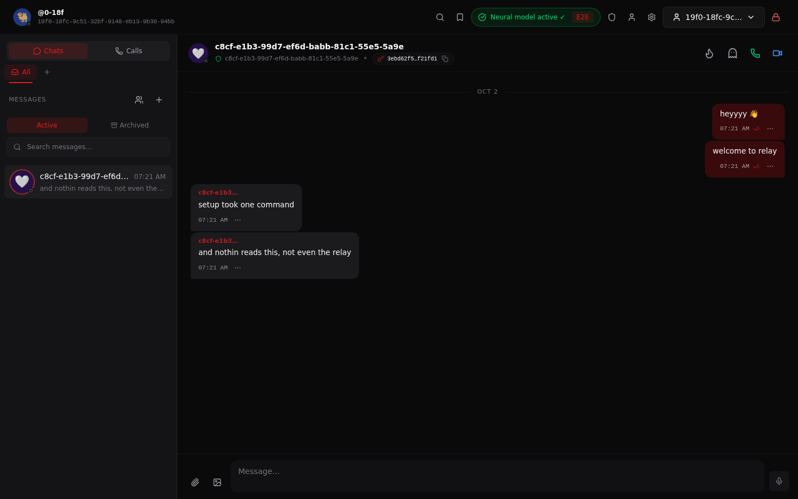
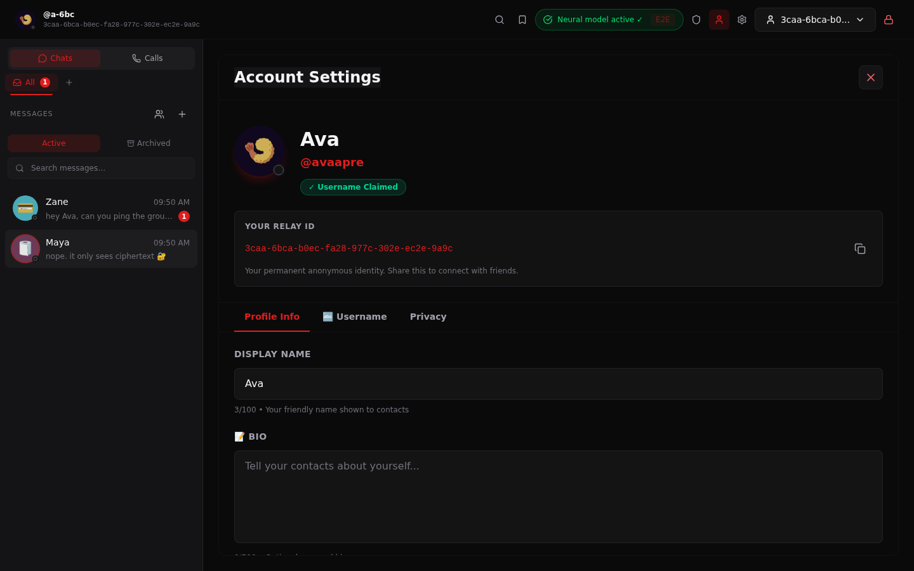
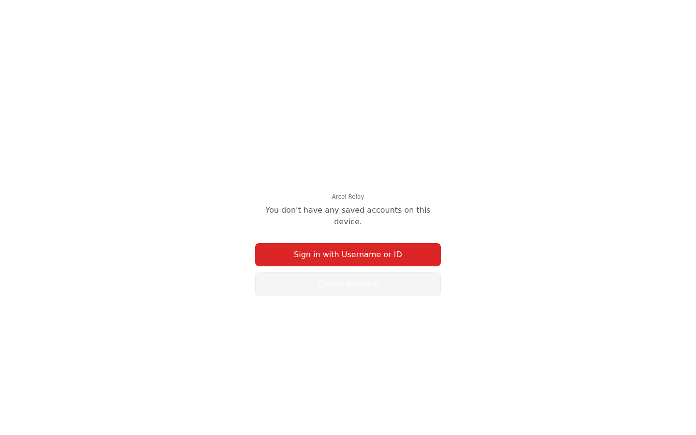
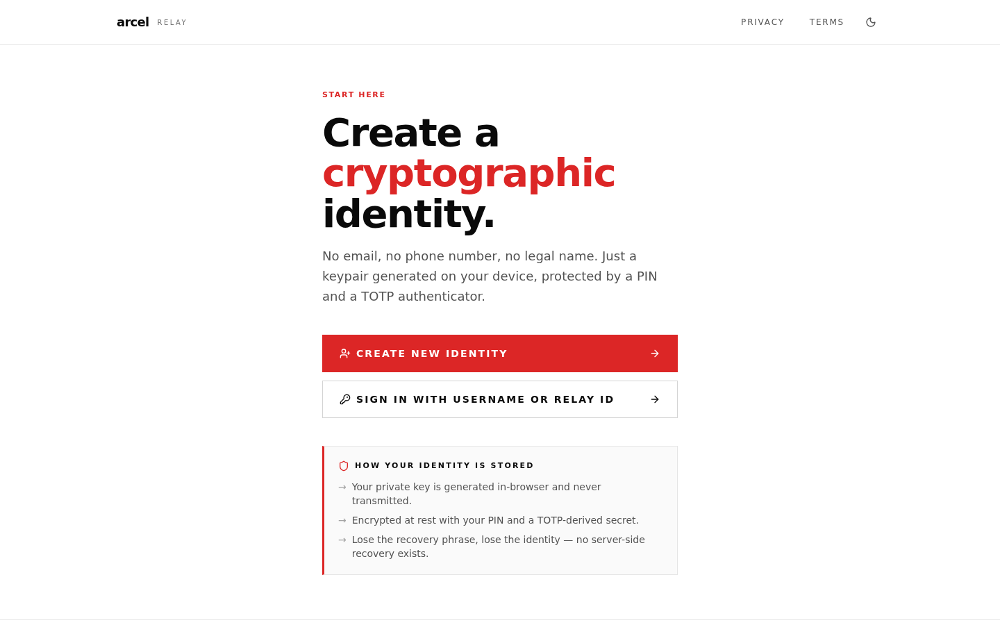
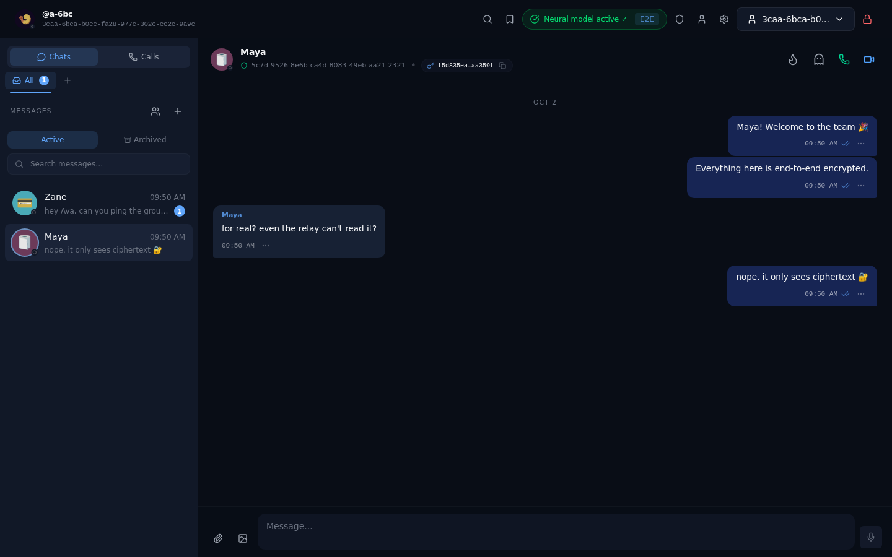
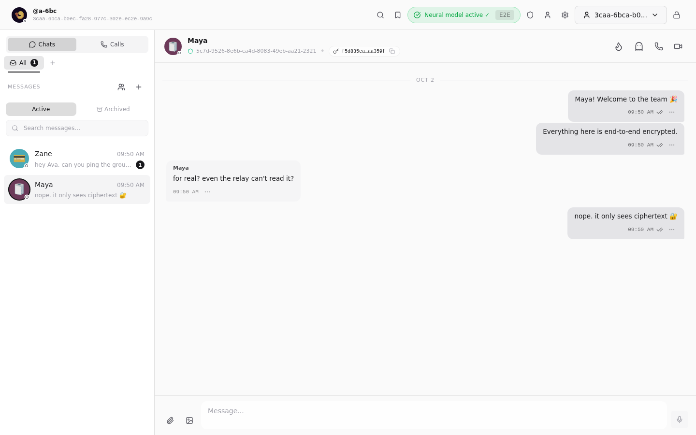
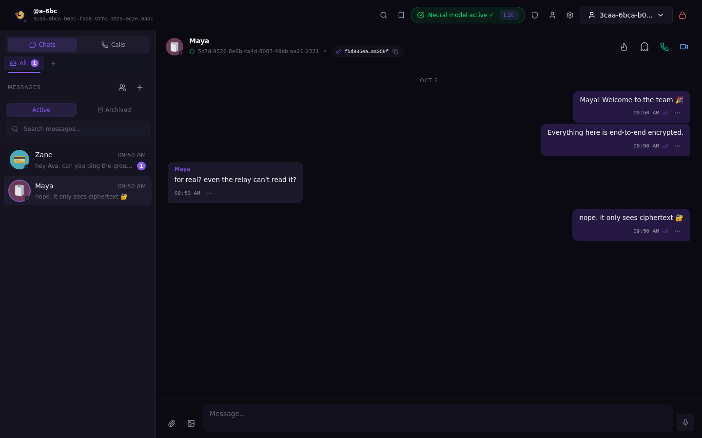
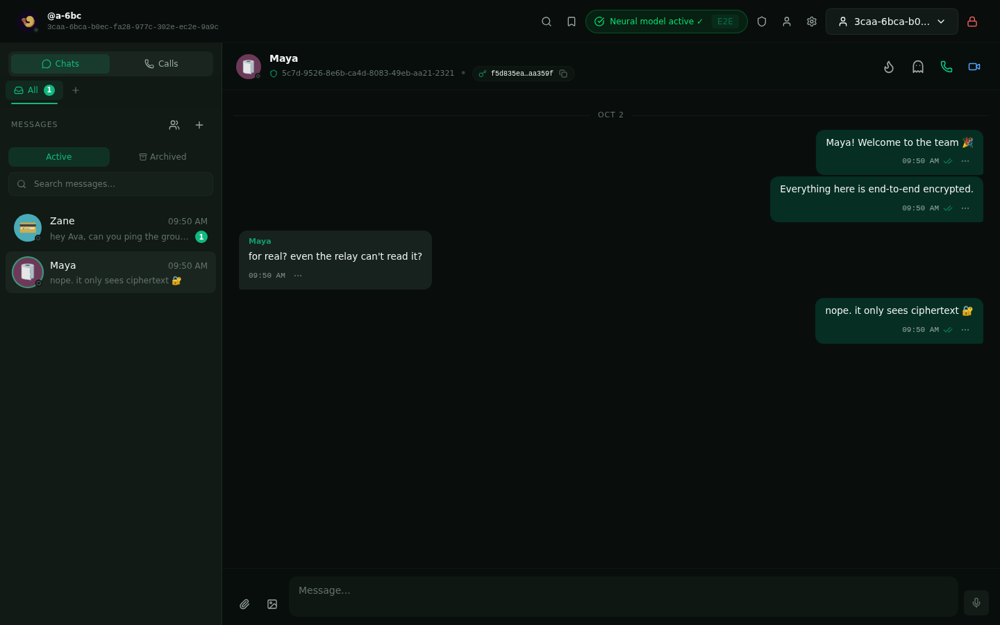

<div align="center">

# Relay

**Private, end-to-end encrypted messaging for high-trust networks.**

Self-host it on a single $5 VPS. No cloud history, no social graph, no ads,
no tracking — and it stays private even after quantum computers arrive.

[](https://github.com/Arcel-Org/Relay/actions)
[](https://github.com/Arcel-Org/Relay/releases)
[](#license)
[](https://nodejs.org)
[](https://docs.docker.com/compose/)

```bash
curl -fsSL https://get.arcel.org/relay.sh | sh
```

*One command. No Node.js, no npm, no `git clone`, no build step. Prebuilt image on GHCR.*



</div>

---

## Install

You need **only Docker** (with the Compose v2 plugin), `curl`, and `openssl`.
Run the one-liner, answer one question (your public domain), and Relay is up:

```bash
curl -fsSL https://get.arcel.org/relay.sh | sh
```

That downloads the installer, which:

1. Fetches **only** `docker-compose.yml`, `docker-compose.release.yml`, and an
   env template — never the whole repo, nothing to compile.
2. Generates a production `.env` with random secrets (`SESSION_SECRET`,
   `TOTP_ENCRYPTION_KEY` via `openssl`) and derives every other value from
   your URL: the `wss://` relay address, the allowed origin, and the WebAuthn
   passkey settings.
3. Creates the shared `proxy-net` network, pulls the prebuilt image, and
   starts the stack.

Prefer to run the script directly (same thing, no `get.arcel.org` in the
middle)?

```bash
curl -fsSL -o quickstart.sh https://raw.githubusercontent.com/Arcel-Org/Relay/master/scripts/quickstart.sh
bash quickstart.sh --url https://relay.example.com --yes    # fully automated
```

### What you still do (15 minutes, once)

Relay binds to **loopback only** by design — the ports are never exposed to
the internet. You:

1. **Point a DNS `A` record** at your server (or `CNAME` for a subdomain).
2. **Terminate TLS** with a reverse proxy (nginx, Caddy, or Cloudflare) — the
   app is `http://127.0.0.1:3000`, the WebSocket relay is
   `http://127.0.0.1:8080`.
3. Set `TRUST_PROXY_HEADERS=true` in `relay/.env` if you're behind a proxy,
   then restart.

Both service ports are loopback-bound, so there is no firewall surface for
the app itself — only your reverse proxy listens on the public interface.
Copy-paste configs below. The relay's WebSocket uses the **same origin and
port** as the page (`wss://relay.example.com`), and the app server tunnels
WS upgrades to the relay internally — so a single reverse-proxy route is
all you need.

**nginx** (the `Upgrade`/`Connection` headers are **required** — without
them the WebSocket dies at the proxy)

```nginx
server {
    listen 443 ssl;
    server_name relay.example.com;

    ssl_certificate     /etc/letsencrypt/live/relay.example.com/fullchain.pem;
    ssl_certificate_key /etc/letsencrypt/live/relay.example.com/privkey.pem;

    location / {
        proxy_pass http://127.0.0.1:3000;
        proxy_http_version 1.1;
        proxy_set_header Upgrade $http_upgrade;      # wss tunnel (relay)
        proxy_set_header Connection "upgrade";      #   → tunnelled to :8080
        proxy_set_header Host $host;
        proxy_set_header X-Real-IP $remote_addr;
        proxy_set_header X-Forwarded-For $proxy_add_x_forwarded_for;
        proxy_set_header X-Forwarded-Proto $scheme;
        proxy_read_timeout 86400s;
    }
}
```

**Caddy** (automatic HTTPS, WebSocket support built in — this is all you
need)

```caddyfile
relay.example.com {
    reverse_proxy 127.0.0.1:3000
}
```

> For very large deployments, the relay also listens on `/ws` directly —
> you can add an explicit `location /ws` → `http://127.0.0.1:8080` route to
> bypass the app's internal tunnel. It's not required; the single-route
> configs above are correct and recommended.

### Verify it's live

```bash
cd relay
docker compose -f docker-compose.yml -f docker-compose.release.yml ps   # both 'healthy'
curl http://127.0.0.1:3000/api/status
# {"ok":true,"relayReachable":true,"dbReachable":true,...}
```

Then sign up at `https://relay.example.com`, and you have a post-quantum,
end-to-end-encrypted messenger you actually control.

---

## Updating — never breaks your setup

Updating is a **pull**, not a migration. Your data and secrets are never
touched:

```bash
# from the relay/ directory that the installer created:
docker compose -f docker-compose.yml -f docker-compose.release.yml pull
docker compose -f docker-compose.yml -f docker-compose.release.yml up -d
```

Or just run the installer again — it is **idempotent by design**:

- It **never overwrites** an existing `SESSION_SECRET` or `TOTP_ENCRYPTION_KEY`
  (and never edits an existing `.env` value it didn't generate).
- All data lives in the named `app-data` volume, which survives container
  recreation across updates. Your account, conversations, keys, and Vault are
  untouched.
- Services and volume names are stable across releases, so an updated
  `docker-compose.yml` drops in cleanly over the old one.

Before a bigger jump (e.g. between major versions), take a backup first (next
section) — it costs one command and makes any upgrade a no-brainer to roll
back.

---

## Backups

Your history lives on your device, but the server-side store (accounts,
session keys, group directory) lives in the `app-data` volume. Snapshot it
daily:

```bash
docker compose -f docker-compose.yml -f docker-compose.release.yml exec -T app \
  tar czf - -C /app/.data . > backup-$(date +%F).tar.gz
```

Or, if you keep the repo, use the helper: `./scripts/backup.sh` (snapshots to
`./backups/`, optionally on a systemd timer) and `./scripts/restore.sh` to
restore. The full backup → restore cycle is documented and exercised in
[`docs/DEPLOY.md`](docs/DEPLOY.md) §5–§6.

---

## Why Relay

Most messengers make a trade you can't verify: *our servers are secure —
trust us.* Relay inverts that. The whole stack is open source, the
cryptography is documented, and the design gives the operator as little to
abuse as physics allows:

- **End-to-end encrypted** — messages are encrypted before they leave your
  device. The relay server is a dumb pipe: it forwards ciphertext and
  eventually deletes it.
- **Post-quantum from day one** — hybrid X25519 + ML-KEM768 key agreement
  defends against *harvest now, decrypt later.*
- **No cloud history** — the relay purges messages after 20 minutes. The only
  persistent copy lives in your encrypted local store.
- **Self-hostable** — one command brings up the whole product on hardware you
  control. No accounts with anyone, no phone-number requirement.
- **Verifiable** — every key, every format, every retention decision is in
  this repository. Security isn't a feature you're asked to believe in.

## Features

- **Hybrid post-quantum E2E encryption** — X25519 + ML-KEM768 key agreement
  with per-message key rotation, ChaCha20-Poly1305 (AEAD)
- **20-minute TTL** — relay-held messages auto-delete; local history persists
  encrypted under your private key
- **Relay ID identity** — a cryptographic identifier derived from your public
  key (`abcd-1234-…-ef90`, self-certifying, no server vouches for it),
  optionally paired with a claimed `@username`
- **Two-factor login** — TOTP + PIN; TOTP secrets encrypted at rest, recovery
  via BIP39 mnemonic
- **Passkeys / WebAuthn** — hardware-key login and 2FA
- **Encrypted local store** — IndexedDB, all values encrypted under an
  HKDF-derived key
- **Device sync** — QR-based session transfer; no server-held keys
- **Groups** — end-to-end encrypted group messaging with a public directory
- **Calls** — WebRTC voice/video with ephemeral TURN credentials
- **Vault** — encrypted notes and 2FA accounts locked behind your PIN
- **Privacy controls** — disappearing messages, read receipts, reactions,
  message editing, presence opt-out — all encrypted end to end
- **Compression before encryption** — client-side zlib with a shared chat
  dictionary shrinks payloads so no server sees them
- **Zero data retention** — minimal metadata, no message logging, no social
  graph

## Screenshots

<div align="center">



&nbsp;


</div>

### Themes

Nine selectable themes (default: crimson). A few of them, on the live
messenger:

<div align="center">



&nbsp;
&nbsp;


</div>

## How it works

```
        Browser (app)                          Your server (Docker compose)
┌──────────────────────────┐   HTTPS/WSS    ┌────────────────────────────────┐
│  Next.js web app         │  ────────────▶ │  reverse proxy (nginx/Caddy)   │
│  • key generation        │                │  ─── HTTPS termination ────────│
│  • encrypt/decrypt       │                │  ┌────────────┐   ┌─────────┐  │
│  • local encrypted store │  WSS (relay)   │  │  app :3000 │   │ relay   │  │
│    (IndexedDB, HKDF)     │  ────────────▶ │  │  Next.js   │   │ :8080   │  │
└──────────────────────────┘                │  │  server    │   │ WebSocket│  │
                                            │  └─────┬──────┘   └────┬────┘  │
                                            │        └──────┬─────────┘      │
                                            │               ▼               │
                                            │        ┌──────────────┐       │
                                            │        │ SQLite       │       │
                                            │        │ (sessions,   │       │
                                            │        │  keys, dirs) │       │
                                            │        └──────────────┘       │
                                            └────────────────────────────────┘
```

- Messages are encrypted in the browser and the relay forwards ciphertext —
  it never sees plaintext and cannot read history.
- The relay holds a message for **at most 20 minutes**, then purges it.
- Sessions, WebAuthn credentials, and the group directory live in SQLite;
  message history lives only in each participant's encrypted local store.
- Key exchange is **hybrid X25519 + ML-KEM768**, combined with HKDF-SHA256 —
  breaking the session requires breaking *both* a classical and a
  post-quantum algorithm. See [Security](#security) for the details.

## Security

### Post-quantum hybrid key exchange

Relay's key agreement is a **hybrid of classical and post-quantum
cryptography**, protecting against *harvest now, decrypt later* attacks:

- **Classical**: X25519 elliptic-curve Diffie–Hellman (ECDH)
- **Post-quantum**: ML-KEM768 (NIST FIPS 203)
- **Combination**: both shared secrets are mixed with HKDF-SHA256 into a
  single session key
- **Why hybrid**: quantum resistance *and* classical fallback — breaking the
  session requires breaking both algorithms; a flaw in either alone isn't
  enough. Clients without PQ keys fall back to X25519.

References: [NIST FIPS 203 (ML-KEM)](https://nvlpubs.nist.gov/nistpubs/FIPS/NIST.FIPS.203.pdf),
[Signal PQXDH](https://signal.org/docs/specifications/pqxdh/),
[Apple PQ3](https://security.apple.com/pq3/).

### What the server never sees

- **Plaintext** — payloads are ChaCha20-Poly1305 AEAD, encrypted with
  per-message ephemeral keys
- **Your private key** — stored only as an HKDF-derived ciphertext under your
  PIN, never in plaintext, never sent
- **Message history** — relay TTL is 20 minutes; the only persistent copy is
  your encrypted local store
- **TOTP secrets** — encrypted at rest with a server-only key; recovery codes
  stored as BLAKE3 hashes

See [`docs/PROTOCOL.md`](docs/PROTOCOL.md) for the wire protocol and
[`docs/API.md`](docs/API.md) for the HTTP API. Vulnerabilities: see
[`SECURITY.md`](SECURITY.md).

## Troubleshooting

| Symptom | Cause / fix |
|---|---|
| `docker compose ps` shows `unhealthy` or `starting` for a while | Give the app up to ~75s (it waits for the relay to be healthy before passing its own healthcheck). |
| Healthcheck uses `127.0.0.1`, never `localhost` | Inside the container `localhost` resolves to IPv6 `::1` first; the IPv4-only server refuses it. Already handled in the compose file. |
| Fresh volume errors like `SQLITE_CANTOPEN` (err 14) | The app runs as a non-root user; an empty named volume is root-owned. The image ships a marker that fixes ownership on first mount — if you mount your own pre-existing volume, ensure it's writable by UID 1000. |
| `WS_ALLOWED_ORIGINS` missing | The relay refuses to start without it. The installer sets it from your URL; if writing `.env` by hand, it must list your production origin(s). |
| Dev `.env` values leak into the container | `PORT`, `RELAY_PORT`, and `RELAY_HOST` are pinned inside compose so a dev `.env` can't silently break the container. |
| Relay URL changed but the app still uses the old one | The relay URL is read at *runtime* from `RELAY_WS_URL` — restart the container after editing `.env`; no rebuild needed. |

## Tech stack

| Layer | Technology |
|---|---|
| Frontend | Next.js 16 (App Router), React 19, TypeScript |
| Styling | Tailwind CSS — 9 selectable themes (default: crimson) |
| Cryptography | @noble/curves (X25519), @noble/post-quantum (ML-KEM768), @noble/ciphers (ChaCha20-Poly1305), @noble/hashes (HKDF-SHA256) |
| Auth | TOTP (otpauth), BIP39 mnemonics, WebAuthn/passkeys (@simplewebauthn) |
| Local storage | IndexedDB (idb-keyval) — all values encrypted |
| Server storage | @libsql/client (SQLite) — sessions, WebAuthn credentials, group directory |
| WebSocket | ws — relay server for message forwarding |
| Calls | WebRTC (voice/video) with ephemeral TURN credentials |
| State | Zustand · Animations · Framer Motion |

## Project structure

```
relay/
├── app/                    # Next.js app: pages, auth flows, legal, security, vault
│   ├── api/                #   API routes: auth, groups, profile, TURN, status, admin
│   ├── app/                #   The messenger (account, settings, admin)
│   ├── auth/               #   Signup / login / recovery
│   ├── setup/              #   Onboarding steps
│   └── legal/, security/   #   Transparency pages (canary, privacy, terms)
├── components/             # 40+ UI components
├── lib/
│   ├── crypto/             # Identity, key agreement, encryption, recovery
│   ├── messaging/          # Send/receive, key exchange, disappearing messages
│   ├── db/                 # IndexedDB (client) + SQLite (server)
│   ├── vault/              # Encrypted notes + 2FA, device sync
│   ├── calls/, webrtc/     # WebRTC signaling and negotiation
│   └── security/, platform/, ...
├── server/
│   ├── relay-node.ts       # Relay server (WebSocket, Node)
│   └── relay-schemas.ts    # Wire message schemas
├── scripts/                # quickstart.sh (installer), setup.sh, update.sh, backup.sh
├── docs/                   # DEPLOY, PROTOCOL, API, crypto review
├── docker-compose.yml      # app + relay (+ optional TURN)
├── Dockerfile
└── .github/                # CI workflows (lint, type-check, test, build, secret scan)
```

## Development

```bash
npm install
npm run dev        # starts the relay (:8080) and the Next.js app (:3000) together
```

Or separately: `npm run dev:next` (frontend) and `npm run relay` (relay
server).

```bash
npm run lint       # eslint
npm test           # unit tests (vitest)
npm run build      # production build (app)
npm run build:relay
npm run test:e2e   # Playwright end-to-end (builds with a test relay first)
```

Self-hosting from source (instead of the prebuilt image) is fully supported:
`git clone` + `./scripts/setup.sh --up`. The image-based path is the
recommended, turnkey route.

## Roadmap

Relay is a working product, not a prototype — the backend (WebSocket relay,
auth API, WebRTC calling, group directory, SQLite persistence) is live and
tested. Remaining work is tracked in [`FEATURES.md`](FEATURES.md):

- Link previews (Open Graph fetch)
- Message scheduling
- View-once media
- Persistent per-conversation drafts
- Desktop keyboard shortcuts

## License

Dual-licensed, matching where each part runs:

- **Client — the Next.js web app** (`app/`, `components/`, `lib/`): [MIT](LICENSE)
- **Relay server** (`server/`): [AGPL-3.0](server/LICENSE)

You may self-host and run the whole stack for any purpose. If you modify and
**operate the relay server as a network service**, AGPL requires you to
publish your modifications. The web client is freely usable under MIT.

## Contributing

Open an issue for bugs or questions, and see
[`CONTRIBUTING.md`](CONTRIBUTING.md) before opening a PR. Found a security
issue? Please read [`SECURITY.md`](SECURITY.md) and disclose it privately to
`security@arcel.org` rather than in a public issue.

---

<div align="center">

[get.arcel.org](https://get.arcel.org) &nbsp;·&nbsp; [Docs](docs/DEPLOY.md) &nbsp;·&nbsp; [Security](SECURITY.md) &nbsp;·&nbsp; [Changelog](https://github.com/Arcel-Org/Relay/releases) &nbsp;·&nbsp; [Contact](mailto:contact@arcel.org)

</div>
